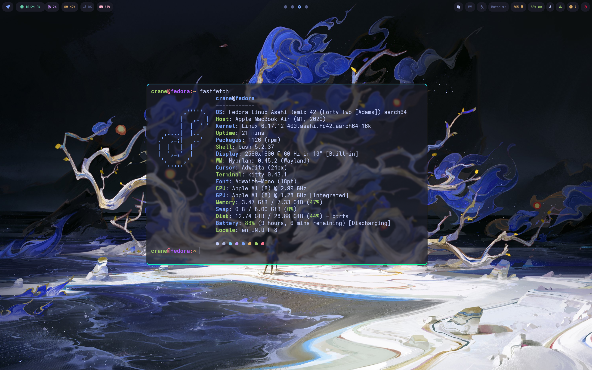
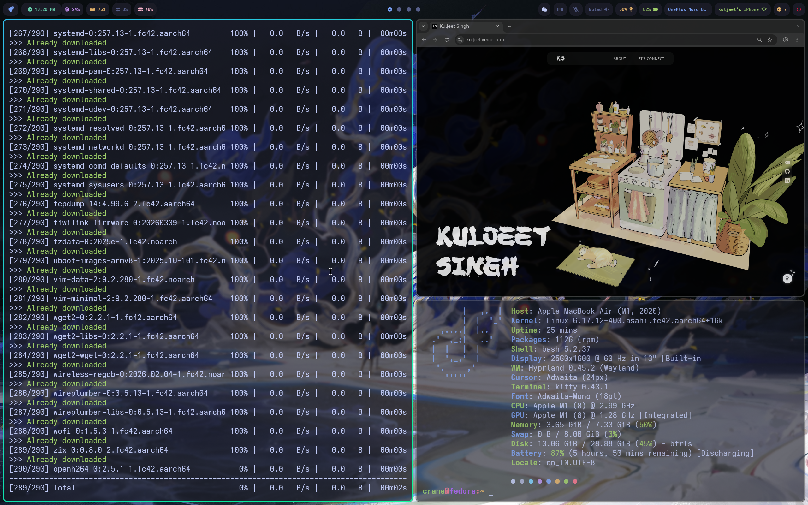
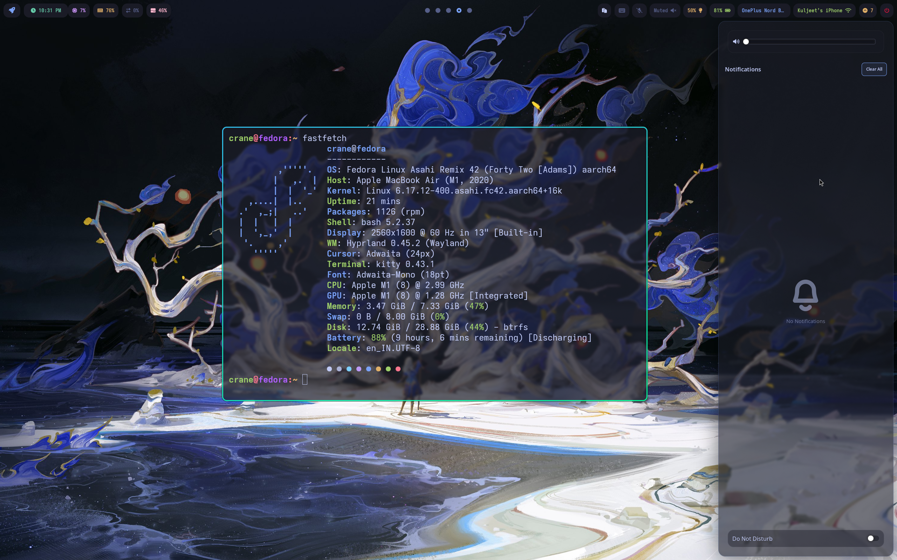

My personal dotfiles and custom scripts. This repo is mainly for setting up my Linux environment quickly and keeping things consistent across systems.

It’s focused around Hyprland (Wayland) with configs for the common tools I use every day. These files are opinionated and tailored to my workflow, but you’re welcome to take whatever is useful.




Currently running on Fedora Asahi Remix (M1 Mac). The core setup includes:

- **Hyprland** – window manager
- **Waybar** – status bar
- **Wofi** – app launcher
  
- **Kitty** – terminal
- **GTK 3** – theming (including custom Python/GTK scripts)
- **Swaylock / SwayNC** – lockscreen & notifications
- **fastfetch / htop** – system info & process viewer
- **Bash** – custom shell scripts and aliases
- **Swaync** - customizable notification daemon and GTK-based control center designed for Wayland compositors
  

Everything lives here so I can bootstrap a new system without starting from scratch.

```text
.
├── bash/         # Custom shell scripts and aliases
├── fastfetch/    # fastfetch config
├── gtk-3.0/      # GTK theme settings
├── htop/         # htop configuration
├── hypr/         # Hyprland configs
├── kitty/        # Kitty terminal config
├── swaylock/     # Lockscreen config
├── swaync/       # Notifications config
├── wallpaper/    # Wallpapers
├── waybar/       # Waybar config
└── wofi/         # Wofi launcher config
```
